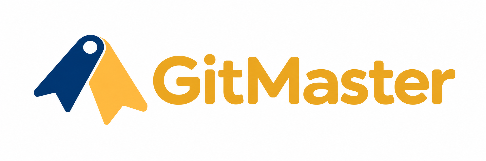

  

面向 Git 初学者的桌面工具，让提交、分支与文件差异更容易理解。

  <a href="https://github.com/C-h-i-M-o/GitMaster/releases">下载与版本</a> ·
  <a href="https://github.com/C-h-i-M-o/GitMaster/issues">问题反馈</a> ·
  <a href="LICENSE">MIT 许可证</a>

## 功能

- **看懂项目历史**：查看提交、分支和文件变化，搜索已加载的提交。
- **整理本地修改**：对比工作区与暂存区，选择文件暂存、取消暂存并提交。
- **恢复文件与清理临时内容**：预览后将文件恢复到暂存区或选定版本；清理选中的未跟踪文件需要再次确认。
- **管理分支**：创建和切换本地分支，查看本地与远端分支。
- **与团队协作**：克隆仓库、获取远端更新、推送提交并整合修改；普通文本冲突可在应用中处理。
- **阅读和编辑文件**：浏览目录、查看差异、编辑文本，支持手动保存和可选自动保存；大文件按页阅读。
- **使用自己的终端**：在项目中打开终端，按需使用熟悉的 Git 命令与 shell。
- **AI 助手（开发版）**：在独立 AI 工作区对话、阅读与修改文件、运行一次性命令及后台任务；支持自定义 OpenAI Chat Completions、Responses 和 Anthropic Messages。模型密钥存入系统凭据库，权限可选择只读、工作区可写或完全访问。现有 Git 工作台和手动终端继续保留。

## 下载与安装

**首版准备中，尚未提供经过完整验收的正式安装包。** Windows 与 macOS 计划同时发布；macOS 将在后续 Mac 设备上测试和构建。可在 [Releases](https://github.com/C-h-i-M-o/GitMaster/releases) 查看后续版本。

正式包发布后，按以下顺序安装：

1. 从 [Git 官网](https://git-scm.com/install/) 安装系统 Git。GitMaster 不附带或自动安装 Git。
2. 在 Releases 选择与系统和处理器架构匹配的安装包。`Source code` 压缩包是源码，不能直接安装。
3. Windows 运行安装程序；macOS 打开 DMG，将 GitMaster 拖入“应用程序”。具体系统要求、首次打开提示及签名状态以对应版本说明为准。

最终用户无需安装 Node.js、Rust 或编译器。Windows 安装包将负责缺失的 WebView2 运行环境；该安装流程仍在验收中。

首版 Windows 安装包不使用代码签名，系统可能显示未知发布者或安装提示。请从本项目 Releases 下载，并按版本说明核对文件校验值。

## 快速开始

1. 打开已有 Git 项目，或通过仓库地址克隆项目。
2. 在历史中了解最近的提交，在本地修改中查看文件差异。
3. 勾选需要提交的文件，核对暂存内容，填写说明后提交。
4. 使用获取、整合与推送同步远端。访问私有仓库需要你自己的账号权限和系统认证配置。

提交会包含已有的全部暂存内容，以及本次勾选并自动暂存的文件。执行前请核对范围。

## 使用说明

- 文件默认手动保存：Windows 使用 `Ctrl+S`，macOS 使用 `Cmd+S`。可在设置中开启自动保存；保存失败时草稿会保留。
- 设置按“通用、外观、Git 环境、AI 模型”排列，常用设置直接展示，低频配置归入默认收起的“高级选项”。外观支持浅色、深色、跟随系统，并分别记住深浅主题；包含 27 个 Codex 主题家族（14 个提供浅色变体），切换后自动保存。
- 磁盘缓存始终开启，不设总量配额。通用页以用量条展示 GitMaster 缓存目录实际占用，可清除缓存；项目文件、设置和未保存草稿不会被删除。
- “刷新本地状态”只读取本地仓库；“获取远端”会连接远端服务。
- 切换分支和整合修改前，请先处理未提交的内容。子模块只读展示；特殊仓库配置和非文本冲突可能需要外部 Git 工具处理。
- GitMaster 不保存远端令牌或私钥。认证使用系统中已有的受信任配置。
- 再次启动可恢复项目和已打开文件的位置，未保存草稿不会跨应用重启保存，退出前请保存需要保留的内容。
- 恢复文件会覆盖对应的工作区内容；清理的未跟踪文件无法通过 Git 找回。确认前请核对预览中的文件范围。

| 操作               | Windows  | macOS   |
| ------------------ | -------- | ------- |
| 打开项目           | `Ctrl+O` | `Cmd+O` |
| 保存文件           | `Ctrl+S` | `Cmd+S` |
| 显示或隐藏底部面板 | `Ctrl+J` | `Cmd+J` |
| 打开设置           | `Ctrl+,` | `Cmd+,` |

## 问题反馈

欢迎通过 [GitHub Issues](https://github.com/C-h-i-M-o/GitMaster/issues/new/choose) 反馈问题。请附上应用版本、操作系统、复现步骤及预期结果；截图和日志请先移除令牌、私有地址及敏感正文。

本项目采用 [MIT 许可证](LICENSE)。

## AI 助手开发与验证

先在“设置 → AI 模型”添加提供商、协议、基础 URL 和模型容量；保存后在 AI 工作区选择模型。API 密钥留空表示保留旧密钥，清除使用独立按钮；本机无认证服务可以不填密钥。测试连接需要主动点击，真实服务可能计费。

“通用 → AI 对话”提供工作步骤展示与收起时机，默认“标准 / 回答结束后”。“通用 → AI 终端”可只读检查当前项目 Windows 沙箱权限；修复前会展示确切目录与备份位置，必须单独确认。不会自动提权或改用完全访问。

AI 内置 8 项 Git 查询工具，以及暂存、取消暂存、提交、创建分支和切换本地分支 5 项写工具。专用写工具每次均需确认；现有 Shell 权限行为保持不变。内置 `/git-development-summary <提交ID…>` 可按指定提交生成开发总结，不读取宿主 Codex 聊天或全局记忆。

标准模式复用 DeepSeek Harness `0.2.2-rc.1` 的循环、工具、权限、任务和模型适配器，只新增桌面桥接与界面。Windows 受限 Shell 使用上游 ACL 沙箱，会调整工作区目录 ACL，存在硬链接、读取和网络隔离限制；完全访问会扩大到当前账户可用文件与命令，启用前需要确认。运行时不自动读取项目插件或环境密钥，不自动重放历史命令。

开发要求 Node 24 LTS 和根 `packageManager` 固定的 pnpm。执行 `pnpm install --frozen-lockfile`，再用 `pnpm tauri dev --no-watch` 启动桌面；`pnpm test:agent` 运行独立 Agent 回归，`pnpm build` 同时准备内置 Node 与生产依赖，`pnpm tauri build --no-bundle` 构建 Release 可执行文件。生成的运行资源不纳入 Git；开发机首次部署需下载依赖，最终用户无需安装 Node/pnpm。

当前实现与已验证范围见 [AI spec-plan](docs/ai-agent-spec-plan.md)、[验证记录](docs/verification.md) 和 [第三方许可](THIRD_PARTY_NOTICES.md)。浏览器预览仅展示 UI；macOS、干净系统和完整视觉复刻仍需各自验收，不能以构建成功替代。
